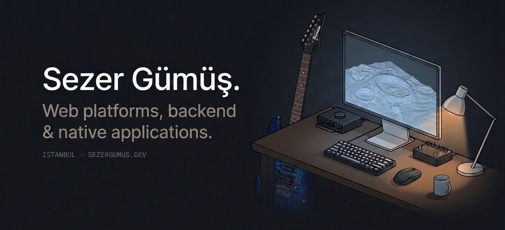

  

  <a href="https://sezergumus.dev"><b>Portfolio</b></a> &nbsp; / &nbsp;
  <a href="https://blog.sezergumus.dev"><b>Blog</b></a> &nbsp; / &nbsp;
  <a href="https://www.linkedin.com/in/sezergumus"><b>LinkedIn</b></a> &nbsp; / &nbsp;
  <a href="mailto:hello@sezergumus.dev"><b>Get in touch</b></a>

 

I’m **Sezer**, a **Full-Stack Software Engineer** based in Istanbul building production web applications, backend systems, and interactive interfaces with **TypeScript, React, Next.js, Node.js, and Python**.

Currently working on frontend engineering and LLM code evaluation at **Outlier AI**, alongside full-stack client platforms and AI automation at **Draft Works**. On the side, I build native desktop apps in **Rust / Tauri** and audio software in **C++ / JUCE**.

## Selected work

<table>
  <tr>
    <td width="50%" valign="top">
      01 / 3D &amp; SPACE
      <h3><a href="https://github.com/Sezergumus/lunaris">Lunaris</a></h3>
      
Interactive lunar south pole landing planner and 3D terrain explorer built on NASA LOLA data and JPL DE421 ephemeris for NASA Space Apps 2026 (Galactic Problem Solver).

      
TypeScript · React · Three.js · FastAPI

      

        <a href="https://lunaris.sezergumus.dev"><b>Explore Lunaris →</b></a> &nbsp;·&nbsp;
        <a href="https://github.com/Sezergumus/lunaris">Repo</a> &nbsp;·&nbsp;
        <a href="https://blog.sezergumus.dev/blog/building-lunaris">Write-up</a>
      

    </td>
    <td width="50%" valign="top">
      02 / AUDIO &amp; NATIVE
      <h3><a href="https://github.com/Sezergumus/tini">Tını</a></h3>
      
Standalone Windows guitar rig and DAW VST3 plugin with Neural Amp Modeler (<code>.nam</code>) inference, cabinet IR loader, and a full pedalboard chain.

      
C++ · JUCE · VST3 · Audio DSP

      

        <a href="https://sezergumus.github.io/tini/"><b>Check out Tını →</b></a> &nbsp;·&nbsp;
        <a href="https://github.com/Sezergumus/tini">Repo</a>
      

    </td>
  </tr>
  <tr>
    <td width="50%" valign="top">
      03 / INFRASTRUCTURE
      <h3><a href="https://github.com/Sezergumus/koru-uptime">Koru Uptime</a></h3>
      
Self-hosted uptime monitoring, incident alerting, and status page platform built for low-overhead reliability on SQLite WAL.

      
TypeScript · Node.js · SQLite

      

        <a href="https://github.com/Sezergumus/koru-uptime"><b>Inspect the repo →</b></a>
      

    </td>
    <td width="50%" valign="top">
      04 / INTERACTIVE
      <h3><a href="https://github.com/Sezergumus/focal">Focal</a></h3>
      
Minimalist daily puzzle collection featuring eight tactile micro-instruments designed with no timers or failure states.

      
JavaScript · HTML/CSS · Offline PWA

      

        <a href="https://focal.sezergumus.dev"><b>Play Focal →</b></a> &nbsp;·&nbsp;
        <a href="https://github.com/Sezergumus/focal">Repo</a>
      

    </td>
  </tr>
</table>

## Recent writing

| Article                                                                                                | What it covers                                                                  |
| :----------------------------------------------------------------------------------------------------- | :------------------------------------------------------------------------------ |
| [What Happens When a Moon Landing Slips by a Week?](https://blog.sezergumus.dev/blog/building-lunaris) | Building Lunaris with NASA LOLA data, a browser-side risk engine, and Three.js. |
| [Behind the Lock: How APIs Know You Are You](https://blog.sezergumus.dev/blog/behind-the-lock)         | A practical breakdown of API authentication, sessions, JWTs, and OAuth.         |

## Stack & tools

| Area                 | Technologies                                                                           |
| :------------------- | :------------------------------------------------------------------------------------- |
| **Frontend**         | TypeScript, JavaScript, React, Next.js, Tailwind CSS, Three.js, Vite                   |
| **Backend & Data**   | Node.js, Express, Python, FastAPI, PostgreSQL, MySQL, MongoDB, SQLite, Redis, Supabase |
| **Systems & Native** | C++, JUCE, VST3, Rust, Tauri, C#, Java                                                 |
| **Cloud & Tooling**  | Docker, GCP, Vercel, Git, Jest                                                         |

 

---

  <b>Build fast. Sweat the details.</b> 
  Say hello or reach out for collaborations: <a href="mailto:hello@sezergumus.dev">hello@sezergumus.dev</a>

  

